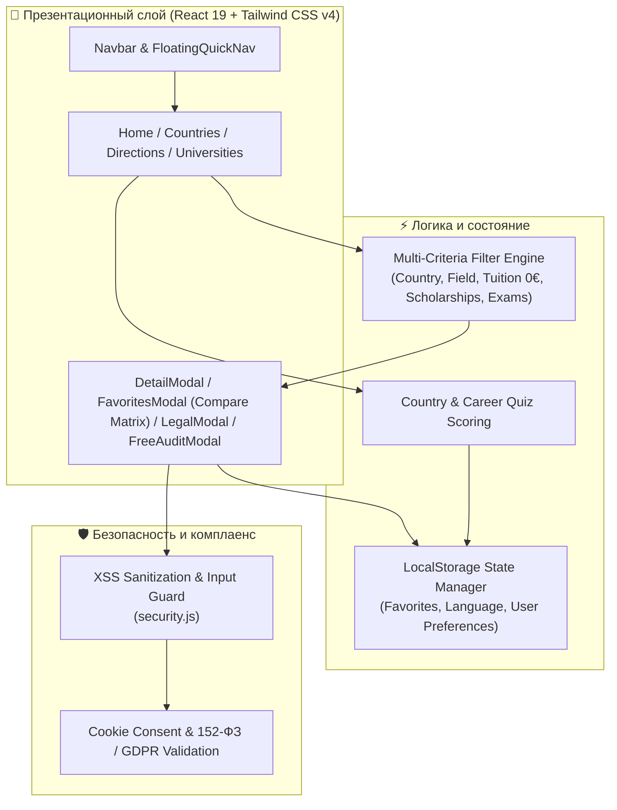

# 🎓 EuroPath — Навигатор по поступлению в Европейские ВУЗы

<div align="center">

[](https://228burger228.github.io/school-333/)
[](https://react.dev/)
[](https://tailwindcss.com/)
[](https://vitejs.dev/)
[](https://lucide.dev/)
[](#-юридический-комплаенс-и-безопасность)

**Интерактивная образовательная платформа в эстетике «Бизнес-Премиум» для подбора университетов, грантов и стипендий в Европе.**

[🚀 Открыть живое демо](https://228burger228.github.io/school-333/) • [✨ Возможности](#-ключевой-функционал) • [🏗️ Архитектура](#️-архитектура-проекта) • [🛠️ Стек](#-технологический-стек)

</div>

---

## 🌟 Ключевой функционал

- 🏛️ **Bento Split Hero и интерактивный трекер**: Сплит-блок первого экрана с ценностным предложением, реальной фотографией кампуса европейского университета, доверительными метриками и интерактивным мини-трекером поступления.
- 🗺️ **Интерактивная дорожная карта (Roadmap 4 шагов)**: Пошаговый разбор этапов поступления (Диагностика → Сбор досье и апостиль → Подача на гранты 0 € → Студенческая виза и переезд) с практическими советами и сроками.
- 📊 **Экспресс-калькулятор оценки шансов (Chance Estimator)**: Наглядный расчет индекса готовности профиля на основе среднего балла (GPA), уровня иностранного языка и бюджета с рекомендациями по целевым странам.
- 🎓 **Стена доверия и реальных кейсов (Success Stories)**: Реальные истории зачисления студентов на бакалавриат и магистратуру с указанием GPA, стипендий (DSU 7 600 €, SI, MEC) и бесплатного обучения (0 €).
- ❓ **Премиальный FAQ в форме пилюль-аккордеонов**: Лаконичные и честные ответы на главные вопросы о бесплатном обучении, визах, стипендиях и совмещении с работой (до 20 ч/нед).
- 🏛️ **Интерактивный атлас 9 стран Европы**: Карточки с ключевыми академическими преимуществами (Германия, Италия, Испания, Франция, Чехия, Австрия, Нидерланды, Швеция, Польша).
- 🔍 **Каталог 30+ ведущих университетов**: Мгновенная многокритериальная фильтрация по странам, направлениям (IT, Бизнес, Инженерия, Медицина, Дизайн), стоимости (включая **0 € бесплатное обучение**) и наличию грантов (DSU, DAAD, MEC, Eiffel).
- ⚖️ **Side-by-Side матрица сравнения ВУЗов**: Сопоставление сохраненных программ в единой таблице с закрепленной (sticky) колонкой критериев для комфортного скролла на смартфонах и планшетах.
- 🧭 **Интерактивный тест «Какая страна тебе подходит?»**: Алгоритмический скоринг по бюджету, языковым барьерам и стилю жизни с расчетом процента совместимости.
- 🎯 **Профориентационный тест**: Определение профессионального профиля и подбор подходящих европейских академических направлений.
- 📱 **Floating Quick Navigation Dock**: Плавающая эргономичная панель быстрого доступа к каталогу, фильтрам, избранному и навигации без необходимости скроллить страницу вверх.
- 🛡️ **Юридический комплаенс (152-ФЗ / GDPR)**: Встроенная политика конфиденциальности, информированное согласие на обработку данных, Cookies-баннер и регламентированный безопасный протокол удаления данных по обращению в поддержку.

---

## 🏗️ Архитектура проекта



---

## ⚖️ Сравнительная матрица ВУЗов (Side-by-Side Matrix)

В модуле избранного реализована аналитическая сравнительная матрица программ:

| Критерий | Особенности реализации |
| :--- | :--- |
| **Рейтинг QS** | Мировой ранг университета и национальный статус |
| **Обучение в год** | Точные цифры или отметка бесплатного обучения в госвузах (**0 €**) |
| **Стипендии** | Государственные и региональные гранты (DSU до 8 000 €, DAAD, MEC) |
| **Языковой порог** | Минимальные баллы IELTS / TOEFL и опции зачисления без сертификата |
| **Стоимость жизни** | Ежемесячные расходы с разбивкой аренды общежитий и питания |
| **Право на работу** | Общеевропейский стандарт работы для студентов (до 20 ч / неделю) |
| **Дедлайны** | Точные сроки подачи документов на осенний и весенний интейки |

---

## 🛡️ Юридический комплаенс и безопасность

Платформа спроектирована с учетом требований законодательства о персональных данных:
1. **152-ФЗ и GDPR**: все формы сбора контактных данных оснащены обязательными чекбоксами явного согласия с прямыми ссылками на Пользовательское соглашение и Политику обработки данных.
2. **Безопасность данных**: исключены опасные функции бесконтрольного удаления или перезаписи локальных баз. Удаление профиля регламентировано через официальный запрос (`privacy@europath.app`).
3. **Строгая санитизация**: утилита [`security.js`](./src/utils/security.js) экранирует все пользовательские инпуты от XSS-уязвимостей.
4. **Автономность**: клиентский стейт сохраняется локально в `localStorage` пользователя без отправки на сторонние непроверенные сервисы.

---

## 🛠️ Технологический стек

- **Ядро**: [React 19](https://react.dev/) (Hooks, Memoization, Strict Mode)
- **Сборщик**: [Vite 8](https://vitejs.dev/) + [vite-plugin-singlefile](https://github.com/richardtallent/vite-plugin-singlefile) (автономная сборка в 1 файл `docs/index.html`)
- **Стилизация**: [Tailwind CSS v4](https://tailwindcss.com/)
- **Иконки**: [Lucide React](https://lucide.dev/) (легковесный SVG-вектор)
- **Микро-интерактив**: `canvas-confetti`, 3D CSS Card Flips
- **Хостинг**: [GitHub Pages](https://pages.github.com/)

---

## 🚀 Быстрый запуск

### 1. Клонирование репозитория
```bash
git clone https://github.com/228burger228/school-333.git
cd school-333
```

### 2. Установка зависимостей
```bash
npm install
```

### 3. Запуск dev-сервера
```bash
npm run dev
```
Локальный адрес: `http://localhost:5173`

### 4. Продакшн-сборка для GitHub Pages
```bash
npm run build
```
Готовый автономный бандл собирается в папку `docs/index.html` и мгновенно готов к развертыванию.

---

## 👥 Команда разработки
- **Архитектура и фронтенд:** Совместная разработка с сохранением оригинальной дизайн-системы «Бизнес-Премиум» (`#8B0000`, `#EFE0CD`, `#FAF5EE`).
- **Лицензия:** MIT
